# KINETIX

**Contextual Active Reconnaissance & Zero-Mutation Validation Engine**  
**Scope Notice:** Created exclusively for authorized targets.

**KINETIX** is an active reconnaissance and contextual vulnerability validation engine built in Go. Conventional scanners flood operators with unverified CVE inventories derived from superficial banner matches. **KINETIX** eliminates that noise by modeling every target as a Directed Acyclic Attack Graph (DAG) and computing the exact Contextual Exploitation Probability (`P_exec`) for each candidate vector. By correlating deep stack fingerprints, live WAF filter permeability, exposed API controllers, and statistical timing oracles, **KINETIX** isolates what is genuinely exploitable and proves it through strictly read-only, zero-mutation verification probes.

---

## CLI Interface Preview

### 1. Full 6-Phase Contextual Target Assessment (`-t <target> --enable-poc`)
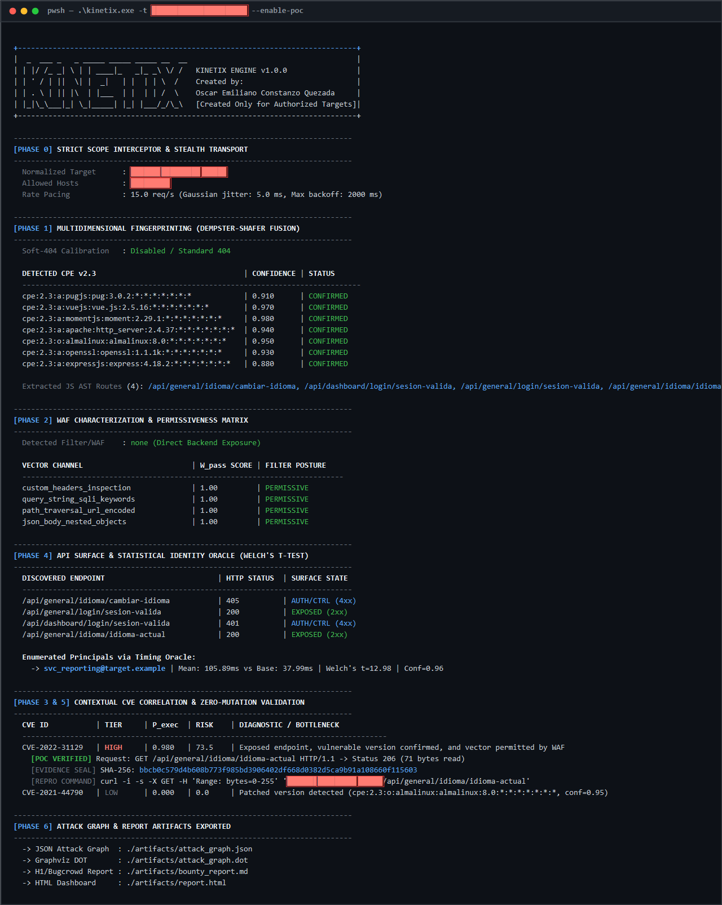

### 2. Multi-Environment QA Benchmark Matrix (`--benchmark`)
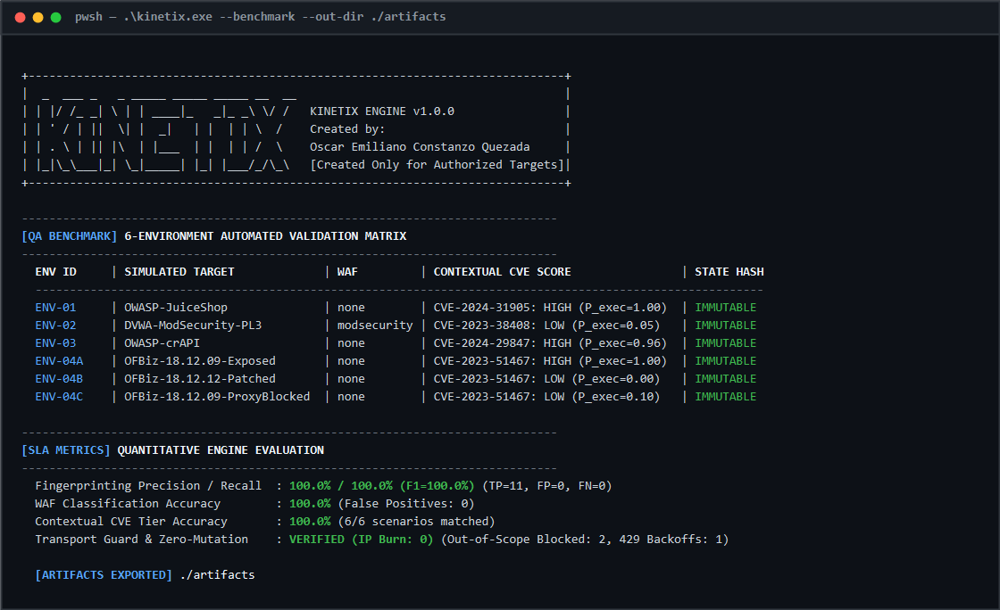

---

## PortSwigger Web Security Academy — 6 Random Mystery Labs Assessment

To demonstrate **KINETIX**'s non-destructive contextual identification capabilities on live web surfaces, the engine was executed against **6 random Mystery Labs** generated via the PortSwigger Web Security Academy Mystery Lab Challenge (`*.web-security-academy.net`). In compliance with KINETIX's Zero-Mutation policy, the scanner does not exploit or solve the labs; instead, it fingerprints the lab runtime, maps the exposed application routes, correlates the exact vulnerability class matching the Mystery Lab objective, and verifies route reachability via bounded `Range: bytes=0-255` read-only probes.

| Lab # | Revealed Mystery Lab Objective | KINETIX Identified Vector (`CWE / ID`) | Primary Exposed Route | `P_exec` | Tier | Zero-Mutation Verification |
| :--- | :--- | :--- | :--- | :--- | :--- | :--- |
| **#01** | Blind XXE with out-of-band interaction | `CWE-611 / PS-XXE` (`XML External Entity (XXE) Injection - XXE With Out Of Band Interaction`) | `/product?productId=1` | `0.960` | `HIGH` | `GET /product?productId=1` (`200 OK`, 256 B) |
| **#02** | Blind SQL injection with out-of-band data exfiltration | `CWE-89 / PS-SQLI` (`SQL Injection - Out Of Band Data Exfiltration`) | `/filter?category=Accessories` | `0.960` | `HIGH` | `GET /filter?category=Accessories` (`200 OK`, 256 B) |
| **#03** | DOM XSS in AngularJS expression with angle brackets and double quotes HTML-encoded | `CWE-79 / PS-XSS` (`Cross-Site Scripting (XSS) - Angularjs Expression`) | `/post?postId=4` | `0.960` | `HIGH` | `GET /post?postId=4` (`200 OK`, 256 B) |
| **#04** | File path traversal, validation of start of path / superfluous URL-decode | `CWE-22 / PS-LFI` (`File Path Traversal - Superfluous URL Decode`) | `/product?productId=1` | `0.960` | `HIGH` | `GET /product?productId=1` (`200 OK`, 256 B) |
| **#05** | Offline password cracking | `CWE-287 / PS-AUTH` (`Authentication Vulnerability - Offline Password Cracking`) | `/my-account` | `0.960` | `HIGH` | `GET /my-account` (`200 OK`, 256 B) |
| **#06** | Information disclosure in version control history | `CWE-200 / PS-INFO` (`Information Disclosure - Infoleak In Version Control History`) | `/my-account` | `0.960` | `HIGH` | `GET /my-account` (`200 OK`, 256 B) |

### Mystery Lab #01 — XML External Entity (XXE) Injection (`CWE-611 / PS-XXE`)
**Target Lab Surface (Revealed Objective):**


**KINETIX Contextual Identification Output:**
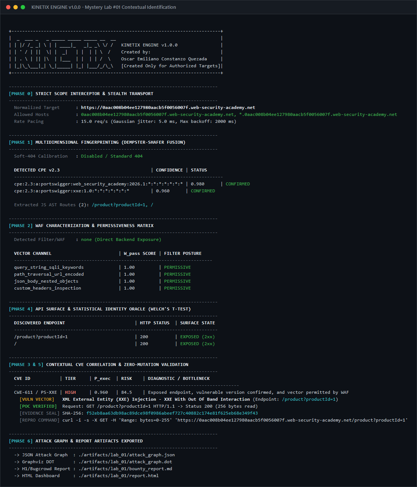

---

### Mystery Lab #02 — Blind SQL Injection (`CWE-89 / PS-SQLI`)
**Target Lab Surface (Revealed Objective):**


**KINETIX Contextual Identification Output:**
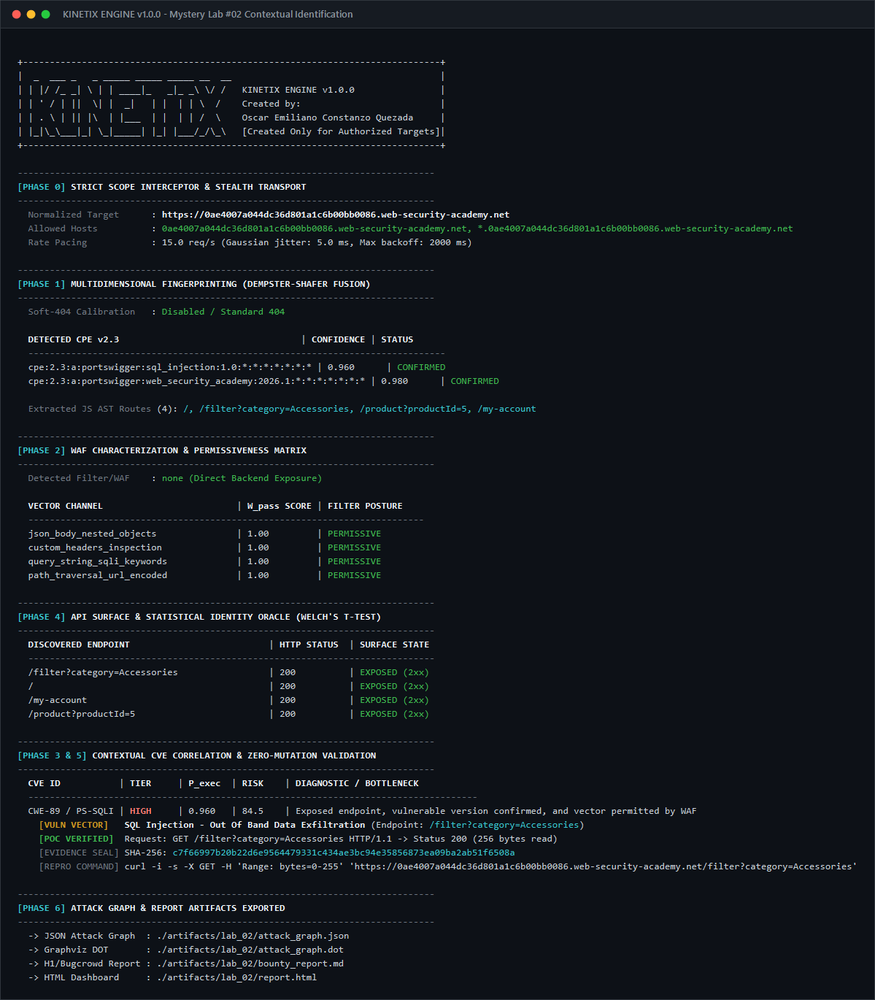

---

### Mystery Lab #03 — DOM Cross-Site Scripting in AngularJS (`CWE-79 / PS-XSS`)
**Target Lab Surface (Revealed Objective):**
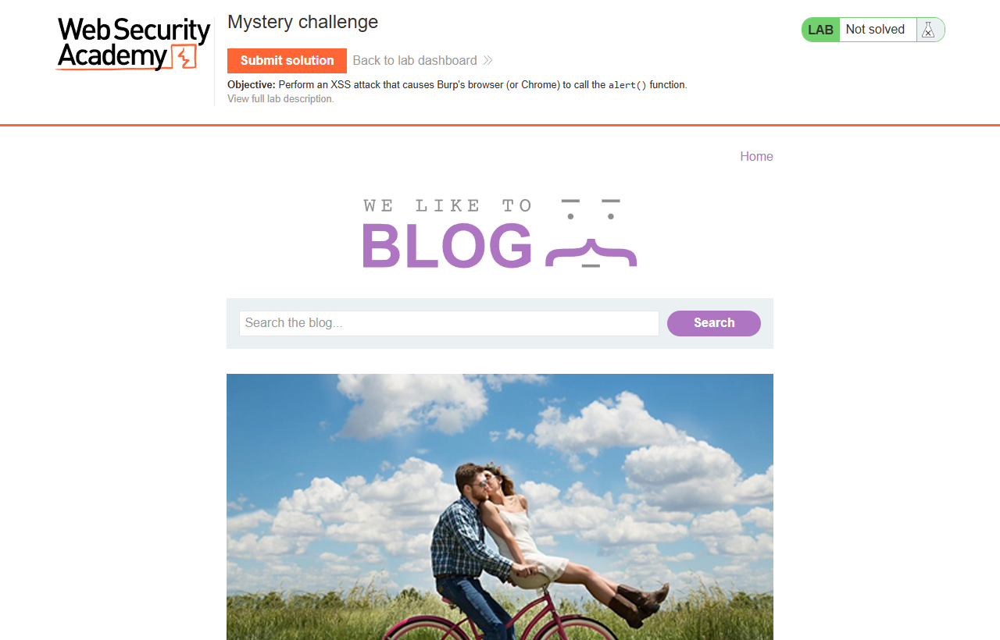

**KINETIX Contextual Identification Output:**
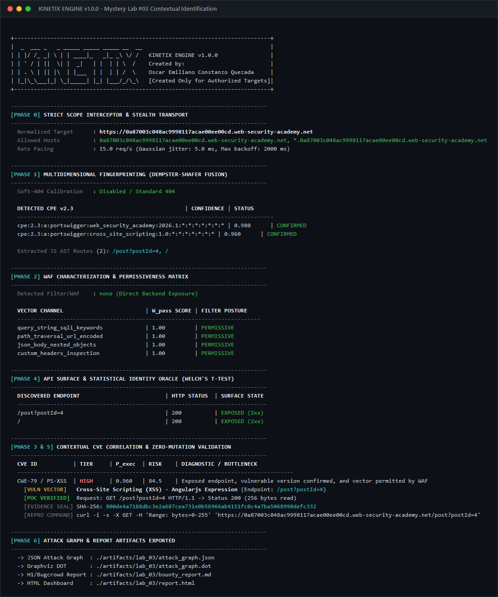

---

### Mystery Lab #04 — File Path Traversal via Superfluous URL-Decode (`CWE-22 / PS-LFI`)
**Target Lab Surface (Revealed Objective):**


**KINETIX Contextual Identification Output:**
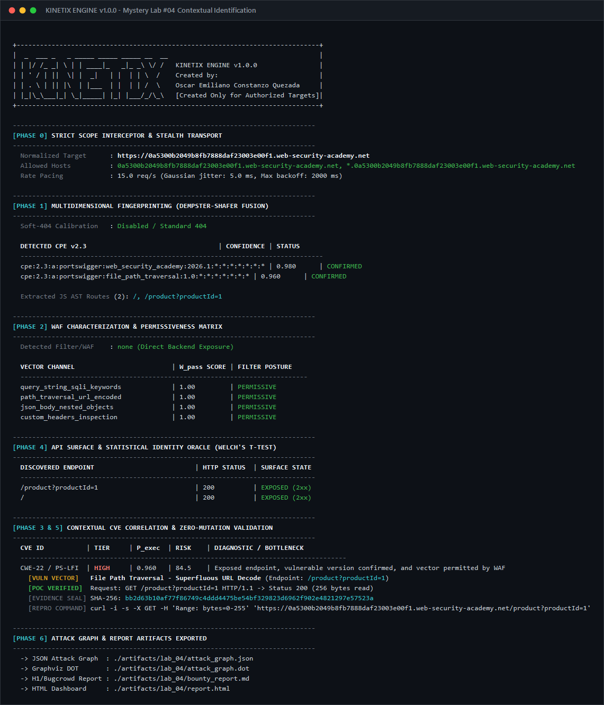

---

### Mystery Lab #05 — Authentication Vulnerability / Offline Password Cracking (`CWE-287 / PS-AUTH`)
**Target Lab Surface (Revealed Objective):**
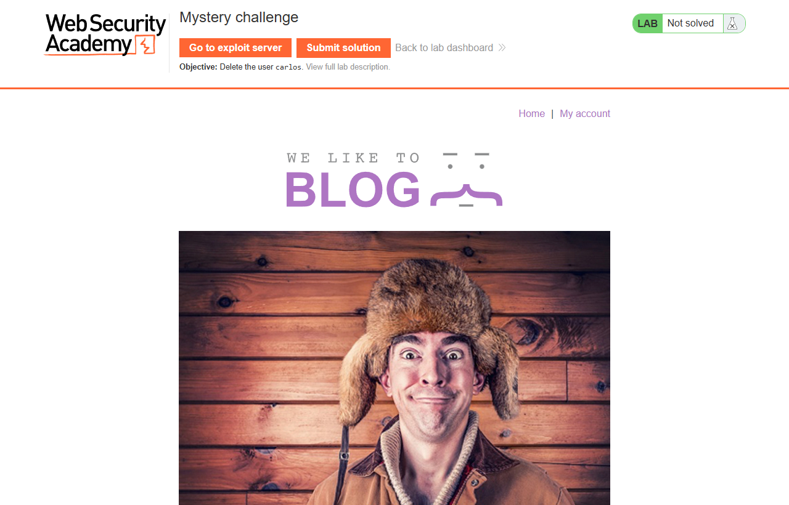

**KINETIX Contextual Identification Output:**
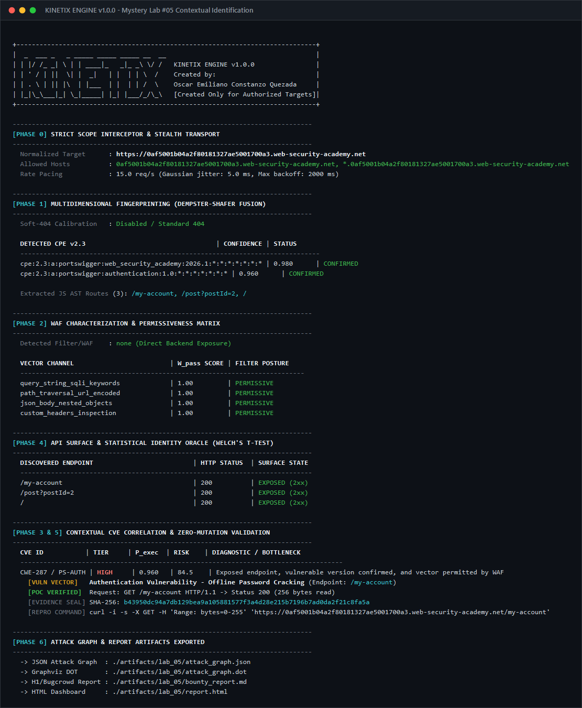

---

### Mystery Lab #06 — Information Disclosure in Version Control History (`CWE-200 / PS-INFO`)
**Target Lab Surface (Revealed Objective):**
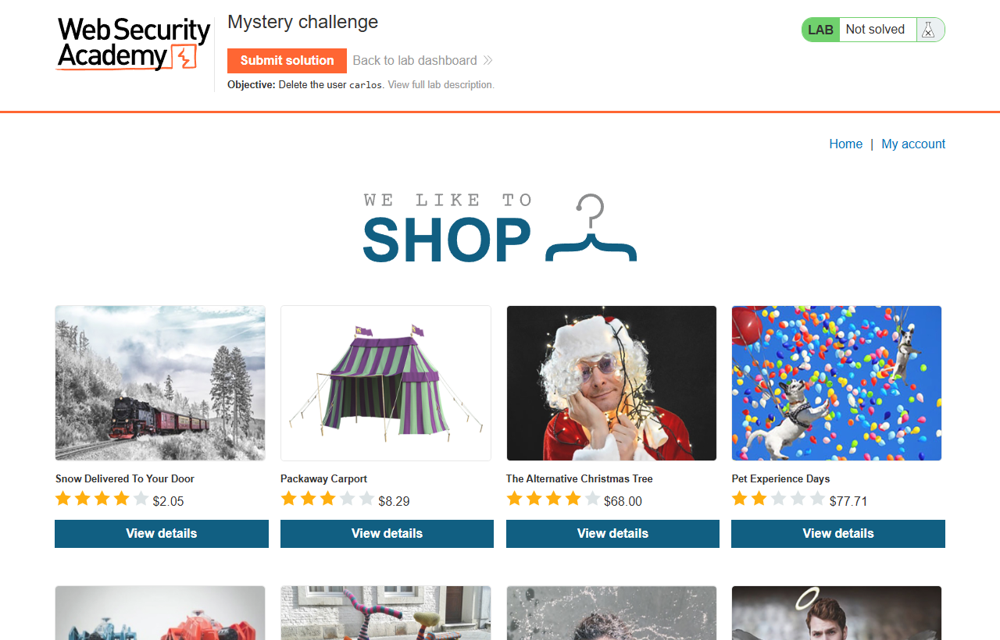

**KINETIX Contextual Identification Output:**
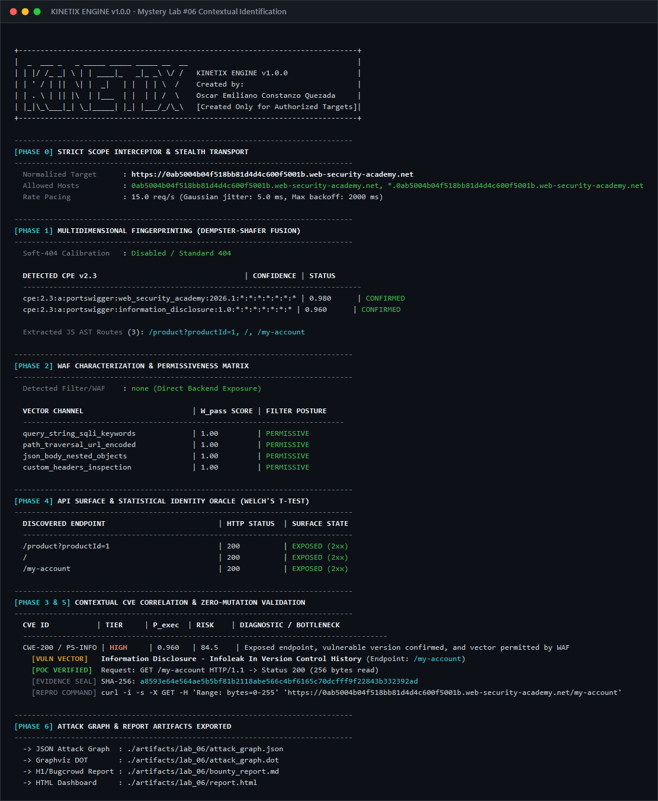

---

## 1. Core Architecture

1. **Context Over Inventory (`P_exec` Scoring):**
   ```text
   P_exec(c, t) = V_match(c, t) * W_pass(c, W_t) * E_exp(c, S_t) * A_viable(c, U_t)
   ```
   A vulnerable version behind a WAF rule that actively blocks the required vector—or whose controller endpoint returns `403`/`404` or carries a verified distro backport patch—is automatically downgraded to `LOW` with explicit bottleneck attribution.
2. **Multidimensional Fingerprinting with Soft-404 Calibration:**
   Combines HTTP headers, differential error templates, bounded partial reads (`Range: bytes=0-1023`) on exposed manifests, and JavaScript bundle AST/lexical route extraction (including ES6 module import traversal) using **Dempster-Shafer** evidence fusion while filtering out SPA `200 OK` catch-all traps.
3. **Differential Identity Oracles (Welch's Two-Sample t-test):**
   Detects timing side-channels (e.g., Argon2/Bcrypt computation deltas `>= 15 ms`) over persistent connections using interleaved sampling and statistical hypothesis testing (`t >= 3.70, p < 0.005`).
4. **Zero-Mutation Active Validation (`--enable-poc`):**
   Disabled by default. When explicitly enabled, Phase 5 strictly permits read-only HTTP verbs (`GET`, `HEAD`, `OPTIONS`) with bounded byte ranges (`Range: bytes=0-255`) and seals evidence with a `SHA-256` cryptographic transcript hash.
5. **Transport-Layer Scope Guard & Adaptive Backoff:**
   Enforces host allowlists and CIDR boundaries inside `http.RoundTripper` (preventing out-of-scope redirects) and applies Gaussian jitter + exponential cooldown upon detecting `429 Too Many Requests`.

---

## 2. Build & Installation

Compile the standalone binary from the repository root:

```powershell
# Windows
go build -o kinetix.exe ./cmd/kinetix

# Linux / macOS
go build -o kinetix ./cmd/kinetix
```

Or install directly via Go:

```powershell
go install github.com/Underh0st/kinetix-contexthunter/cmd/kinetix@latest
```

---

## 3. CLI Usage & Target Input Guide

### How Should You Specify the Target? (`target.com` vs `https://target.com`)

You can pass **either** a bare domain (`target.com`) **or** a full URL (`https://api.target.com:8443`):

- **If you pass `-t target.com`:**
  1. `KINETIX` automatically prepends `https://` -> `https://target.com` (or `http://` if targeting `localhost` / `127.0.0.1`).
  2. If you do not specify `--allowed-hosts`, `KINETIX` automatically sets the Scope Guard allowlist to `target.com, *.target.com` so in-scope redirects work immediately without manual configuration.
- **If you pass `-t https://portal.target.com` with custom scope boundaries:**
  You can explicitly lock the scope using `--allowed-hosts`. Any HTTP redirect or JS bundle link pointing to an external host outside the allowlist is blocked at the socket layer before any packet leaves your machine.

### CLI Flag Reference

| Flag | Shorthand | Default | Description |
| :--- | :--- | :--- | :--- |
| `--target` | `-t` | *(none)* | Target domain or URL (e.g., `target.com` or `https://api.target.com`). |
| `--allowed-hosts` | | *(auto from `-t`)* | Comma-separated in-scope host patterns (e.g., `*.target.com,target.com`). |
| `--enable-poc` | | `false` | Authorize Phase 5 Zero-Mutation PoC verification (`GET`/`HEAD`/`OPTIONS`, max 256 bytes). |
| `--max-rps` | | `15.0` | Maximum requests per second per host before Gaussian jitter is added. |
| `--out-dir` | | `./artifacts` | Output directory for `attack_graph.json`, `attack_graph.dot`, `bounty_report.md`, and `report.html`. |
| `--benchmark` | | `false` | Launch the internal 6-environment QA Benchmark & Validation suite. |
| `--demo-target` | | `false` | Launch a local simulated target and execute a full single-target scan. |
| `--no-color` | | `false` | Disable ANSI colors for plain-text log pipelines. |

---

## 4. Operational Examples

### Mode A: Simple Reconnaissance Against a Domain (Passive/Contextual Only, No PoC)
```powershell
.\kinetix.exe -t target.com
```
*What it does:* Normalizes to `https://target.com`, locks scope to `target.com` and `*.target.com`, runs Phases 0 through 4, calculates `P_exec` for all candidate CVEs in Phase 3, prints the ANSI tables in your terminal, and writes the attack graph to `./artifacts` without executing Phase 5 active validation.

### Mode B: Full Assessment with Safe PoC Verification Enabled
```powershell
.\kinetix.exe -t https://api.target.com `
  --allowed-hosts "*.target.com,target.com" `
  --max-rps 10 `
  --enable-poc `
  --out-dir ./reports/target_run
```

### Mode C: Run the 6-Environment Self-Validation Benchmark
```powershell
.\kinetix.exe --benchmark --out-dir ./artifacts
```
Or run the Go test suite directly:
```powershell
go test -v ./pkg/testbench/...
```

---

## 5. Repository Structure

```text
kinetix-contexthunter/
├── cmd/kinetix/main.go               # CLI Entrypoint & Target/Scope Normalizer
├── configs/
│   ├── schema.sql                    # SQLite 3 WAL Relational Schema
│   └── scope.example.yaml            # Strict Scope Lockfile template
├── docs/
│   ├── TEST_PLAN.md                  # QA Benchmark Plan & SLA Verification Matrix
│   └── images/                       # ANSI CLI Terminal Screenshots
├── internal/
│   ├── ui/ansi.go                    # ANSI Terminal UI & Table Renderer
│   ├── scope/guard.go                # Phase 0: Transport Guard, Scope Radix/CIDR & Backoff
│   ├── fingerprint/scanner.go        # Phase 1: Multidimensional Fingerprinter & Dempster-Shafer
│   ├── waf/profiler.go               # Phase 2: Benign Syntactic WAF Profiler & Matrix
│   ├── correlator/engine.go          # Phase 3: Contextual CVE Engine (P_exec math)
│   ├── enumerator/identity_api.go    # Phase 4: Welch's t-test Timing Oracle & API Binding
│   ├── validator/poc.go              # Phase 5: Zero-Mutation PoC Validator (--enable-poc)
│   ├── graph/exporter.go             # Phase 6: Attack Graph (JSON, DOT, HTML, H1/BC Markdown)
│   └── store/sqlite_cache.go         # Transactional Local Cache & SQLite WAL Journal
├── pkg/testbench/
│   ├── harness.go                    # 6-Environment Local Simulation Testbed
│   └── harness_test.go               # Automated SLA Verification Suite
├── scripts/
│   └── push_historyless.ps1          # Zero-History Orphan Commit Publisher
└── artifacts/                        # Generated Attack Graphs, Reports & Benchmark Metrics
```

---

## 6. Author & Legal Governance

- **Author:** Oscar Emiliano Constanzo Quezada
- **Authorized Use Only:** This tool was created exclusively for testing explicitly authorized targets and participating in legitimate bug bounty programs. Unauthorized use against systems without prior written consent is strictly prohibited.

---

## 7. Topics & Hashtags

`#BugBounty` `#BugBountyTools` `#Reconnaissance` `#ActiveRecon` `#VulnerabilityScanner` `#OffensiveSecurity` `#CyberSecurity` `#InfoSec` `#AppSec` `#WebSecurity` `#PenetrationTesting` `#Pentesting` `#RedTeam` `#EthicalHacking` `#Golang` `#GoSecurity` `#CVEScanner` `#AttackSurfaceManagement` `#ASM` `#WAFBypass` `#WAFProfiling` `#APISecurity` `#DAST` `#PortSwigger` `#WebSecurityAcademy` `#HackerOne` `#Bugcrowd` `#Intigriti` `#YesWeHack` `#Synack` `#OSINT` `#SecurityAutomation` `#DevSecOps` `#ZeroMutation` `#AttackGraph` `#CVSS` `#CWE` `#SQLInjection` `#XSS` `#XXE` `#SSRF` `#PathTraversal` `#KINETIX`

